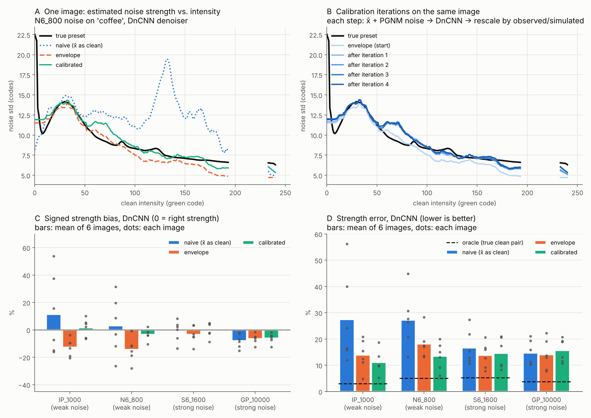
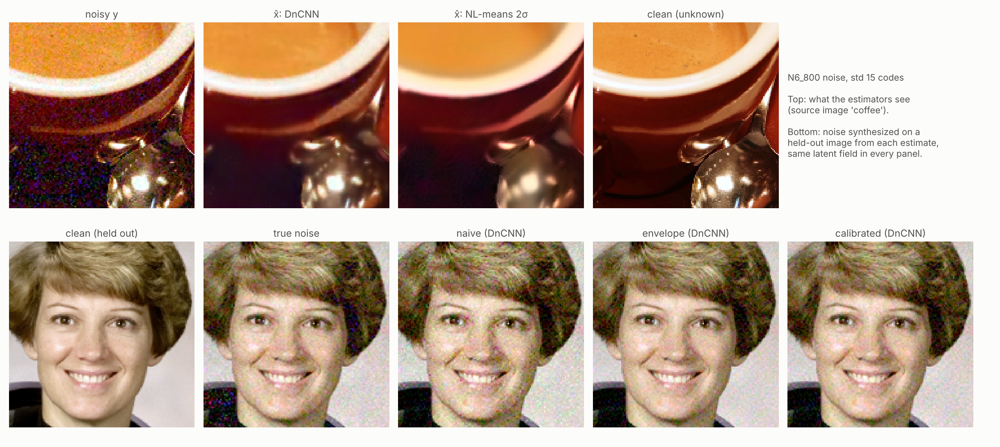
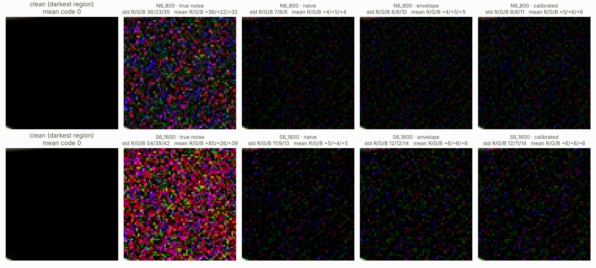

# blind — PGNM parameters from one noisy image and a blind denoiser

Setting: one noisy image y and a blind denoiser D that removes the grain but
also some fine signal. Goal: PGNM parameters (kernel and lookup) that make
noise like y's. Idea: use x̂ = D(y) only for local intensity and for finding
structure, never as the clean image, and let a simulation of the whole chain
cancel what D does to the noise.

```bash
python -m blind.run                    # ~65 min on 4 cores → runs/blind/
python -m unittest tests.test_blind    # seconds
```

## Estimators (`estimate.py`)

| Estimator | Uses |
|---|---|
| `oracle` | the paper's recipe on the true (clean, noisy) pair: the single-image upper bound |
| `naive` | the paper's recipe on (x̂, y): x̂ treated as clean |
| `masked` | residual statistics only on the flattest 40% of x̂ per intensity band (7×7 and 15×15 contrast) |
| `envelope` | `masked`, then only 32×32 tiles whose residual variance is within 1.5× of the 25% lower envelope of tiles of the same intensity |
| `calibrated` | `envelope` + indirect inference: render x̂ + PGNM(θ), denoise, re-measure; move correlations additively and per-intensity strength multiplicatively by the observed − simulated gap (4 iterations × 2 simulations) |

The paper's `pgnm.fit` refuses most single images (its pilot strength curve
needs flat pixels at two or more intensity knots), so every estimator uses one
RMS per channel as the pilot when that happens.

## Synthetic ground truth (`run.py`)

* Clean: 6 images bundled with scikit-image (astronaut, coffee, chelsea, rocket,
  immunohistochemistry, retina).
* True noise: 4 SIDD presets from weak to strong: IP_1000, N6_800, S6_1600,
  GP_10000.
* Denoisers (`denoisers.py`): OpenCV NL-means with h = 1×, 2×, 3× the image's
  true noise std (an experimental condition, unknown to the estimators: 1× leaves
  some noise, 2–3× erase fine signal: its high-pass error correlates −0.8 to −0.99
  with the image's own detail), and the paper's DnCNN trained on real SIDD noise
  (`checkpoints/denoise/real.pt`), run in NumPy so no PyTorch is needed.
* Scoring: render the estimate and the true preset on the 5 *other* images
  (256² center crops, 2 seeds) and compare with the paper's metrics, plus a split
  of the marginal error: strength error (|log std ratio| per channel and
  intensity band, %), signed strength bias (%), offset error (codes).

## Results, means over 4 presets × 6 images

| denoiser | estimator | W1 | strength err % | strength bias % | offset | spatial | color |
|---|---|---|---|---|---|---|---|
| (true clean) | truth (noise floor) | 0.33 | 0.8 | −0.0 | 0.26 | 0.004 | 0.003 |
| (true clean) | oracle | 1.21 | 4.3 | −1.0 | 0.99 | 0.028 | 0.025 |
| NLM 1× | naive | 7.75 | 29.5 | +8.2 | 6.88 | 0.025 | 0.090 |
| NLM 1× | envelope | 6.76 | 21.1 | −2.3 | 6.23 | 0.024 | 0.083 |
| NLM 1× | calibrated | 7.26 | 24.7 | −0.6 | 6.42 | 0.033 | 0.090 |
| NLM 2× | naive | 9.32 | 36.1 | +27.9 | 7.62 | 0.033 | 0.128 |
| NLM 2× | envelope | 6.70 | 18.2 | +9.5 | 5.95 | 0.033 | 0.114 |
| NLM 2× | calibrated | 6.84 | 18.8 | +10.0 | 5.98 | 0.040 | 0.123 |
| NLM 3× | naive | 10.36 | 40.7 | +34.3 | 8.28 | 0.039 | 0.149 |
| NLM 3× | envelope | 6.71 | 19.3 | +12.0 | 5.81 | 0.036 | 0.125 |
| NLM 3× | calibrated | 6.81 | 19.8 | +11.8 | 5.84 | 0.045 | 0.138 |
| DnCNN | naive | 4.84 | 21.5 | +1.4 | 3.90 | 0.019 | 0.030 |
| DnCNN | masked | 3.97 | 16.7 | −2.1 | 3.27 | 0.025 | 0.045 |
| DnCNN | envelope | 3.68 | 15.0 | −9.3 | 3.14 | 0.019 | 0.027 |
| DnCNN | calibrated | 3.70 | **13.7** | **−2.0** | 3.14 | **0.018** | **0.023** |

Per preset: [results.md](results.md).



A: on one image, the naive fit counts leaked signal as noise (the peak near
code 130); the envelope removes it but is too weak above code 90; calibration
lifts it back to the true curve. B: almost all of that happens in the first
iteration. C, D: over the grid, calibration removes the envelope's negative
bias for weak noise; for strong noise (S6_1600, GP_10000) the shadow offset,
not strength, limits every estimator. (`python -m blind.figure_calibration`)

## What it looks like



Top: what the estimators see (noisy y, the two denoisers' x̂, the unknown
clean image). Bottom: noise rendered on a held-out image from the true preset
and from each DnCNN-based estimate, all from the same latent field. S6_1600:
[visual_S6_1600.png](visual_S6_1600.png).



In mid-tones, envelope and calibrated match the true noise closely (orange suit
at code 100: std 11/10/17 for both), naive is too strong. On true black (code
0) every estimate is nearly black (std 8–14), where the true noise is bright
color speckle (N6_800 std 36/23/35, mean +36/+22/+32; S6_1600 mean +85 in red).
The denoiser never outputs true black (x̂ ≈ E[y] includes the offset), so no
pixel tells the lookup what happens there. The averaged scores hide this
because few held-out pixels are pure black. The numbers are consistent with
clipping of zero-mean noise (σ ≈ 62 gives mean 25 and std 36 after clipping),
so a clipping model mapping x̂ back to true black is the likely fix.
(`python -m blind.figure_visual N6_800`, `... shadows`)

## Findings

1. **The lower envelope is the robust step.** With every denoiser it is the
   largest single gain. Under over-smoothing (NLM 2–3×) the naive fit makes noise
   28–34% too strong, because erased signal is counted as noise; the envelope cuts
   that to 10–12% and the strength error from 36–41% to 18–19%. Masking alone
   helps half as much and costs color accuracy, having fewer pixels.
2. **With the CNN denoiser, calibration removes the envelope's selection bias.**
   Picking low-variance tiles makes the envelope 9% too weak; simulating
   D on PGNM noise reproduces that bias, and calibration brings it to −2% with
   the lowest strength error (13.7%) and color error (0.023, the oracle's 0.025)
   of any single-image estimator. It converges in 2 iterations (strength gap
   5.6% → 2.9% → 2.7% → 2.5%).
3. **With NLM, calibration does not help.** The simulation runs on x̂, which has
   already lost the signal NLM erases, so NLM erases less in simulation than on
   y and the leak stays invisible: the +10–12% left at 2–3× is that residual. NLM
   also distorts color correlations (0.08–0.15 everywhere), which no step
   repairs.
4. **The shadow offset is unidentifiable, as expected.** For the strong presets
   W1 is dominated by offset error (S6_1600: 3.4 codes, GP_10000: 6.3 with the
   DnCNN; oracle 1.3 and 1.6). sRGB SIDD noise has a large positive mean in deep
   shadows (clipping and tone curve); every denoiser keeps it as signal. It also
   shifts which intensity each residual is attributed to, which is why strength
   errors stay near 14% for every estimator at S6_1600 and GP_10000 while the
   signed bias is near zero. Recovering it needs a model of where the offset comes
   from (e.g. clipping of a zero-mean distribution, Foi 2009), not more statistics.
5. **The floor.** One image with its true clean pair still leaves 4% strength
   error; the best blind estimate is about 3× that.

## How the method reads in general

noisy = clean + noise with few degrees of freedom that depend on something the
denoised image still shows (here, intensity). A denoiser only gives clean′ and
noise′. A mismatch between what the model, simulated through the same denoiser,
predicts and what is observed has three possible sources: the model lacks
degrees of freedom; the denoiser's interaction with the *real* signal is not
reproduced in simulation (finding 3); or a quantity is unidentifiable from one
image (finding 4). Only the first is a model improvement. Its signature is a
mismatch that persists across denoisers and image content and depends only on
the covariate.

## Caveats

* The noise is PGNM's own (in-model), the clean images are few and small, and
  the denoisers are an NL-means stand-in and a DnCNN trained on SIDD. Real noisy
  images and a modern blind denoiser (Restormer, NAFNet) are the real test.
* The calibration simulates on x̂; a denoiser that erases much signal in regions
  that look flat breaks it (finding 3).

## Taking it local (hand-off)

State: everything above runs on CPU in this repository with
`pip install -e . scikit-image`; no PyTorch is needed. Next steps, in order:

1. **A real denoiser.** Any callable from a uint8 H×W×3 image to a uint8 image works
   (wrap a Restormer, NAFNet, or the DnCNN on GPU):

   ```python
   from blind import estimate
   params = estimate.calibrated(noisy_uint8, my_denoiser)      # a pgnm/5 preset
   from pgnm import save; save("estimated.json", params)
   ```

   Calibration calls the denoiser 1 + iterations × simulations times (9 by default).
2. **Real noise, scored against pairs.** For SIDD, estimate from single noisy
   Validation or Medium images (`PGNM_SIDD_*`, see the top-level README), then
   score the estimate as `experiments.sidd` scores presets (Tab. 1), next to the
   preset fitted on that camera–ISO class's pairs. This leaves the in-model test
   above behind.
3. **Mismatch diagnosis.** Run two or more different denoisers on the same
   images; the part of the calibration gap (`history` in `calibrated`) that
   persists across denoisers and depends only on intensity is a model deficiency;
   the part that changes with the denoiser is the denoiser.
4. **Open problems.** The shadow offset needs a generative explanation (e.g.
   clipping) to become identifiable. Strongly over-smoothing denoisers leak signal
   that the simulation on x̂ cannot reproduce. Other sensors need only the noise
   to be additive in some domain, with a covariate still visible after denoising.

Related experiment in this branch: `textures/` (PGNM as a texture model).
