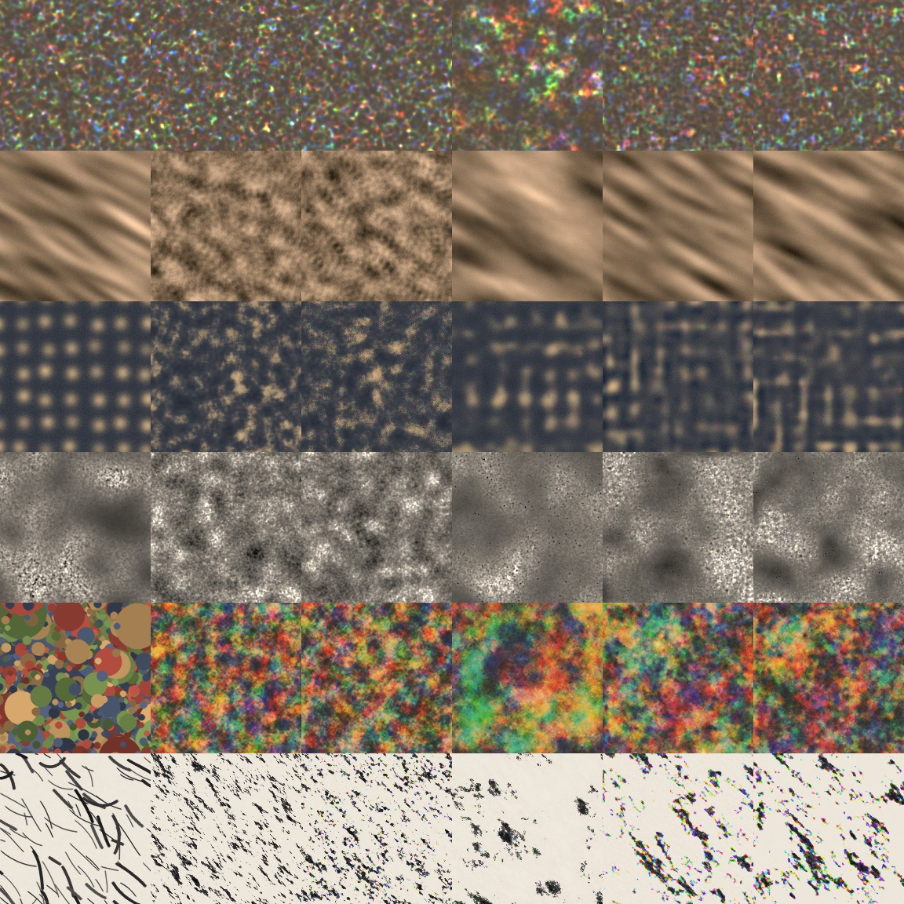

# textures — can PGNM model a random texture?

A side experiment: take PGNM's two fitted arrays (a 25×25 RGB kernel that
correlates Gaussian noise, and a monotone lookup that maps each latent value to
a residual given the clean intensity) and ask how far they go as a *texture*
model. Here the clean image is constant, so the model is a stationary Gaussian
field followed by a pointwise map, close to random-phase noise with histogram
matching. Pre-2000 multiscale methods (Heeger & Bergen 1995, Portilla &
Simoncelli 2000) are the reference point for the pyramid variants.

```bash
python -m textures.run                         # ~5 min on 4 cores → runs/textures/
python -m unittest tests.test_textures         # seconds
```

## What is compared

Six procedurally defined, stationary textures (`generators.py`), from PGNM's
home ground to far from it: `gauss_short` (control), `gauss_long` (correlation
beyond the kernel), `lattice` (repetitive, period 32 px), `cascade` (grain whose
strength follows a coarse field), `dead_leaves` (occluding disks: edges) and
`strokes` (hand-drawn-like hatching).

Models (`models.py`), all fitted on 8 samples of 512²:

| Model | What it is |
|---|---|
| PGNM | constant clean image (code 128), `pgnm.fitting` with every pixel flat |
| PGNM, normal scores | same, but correlations measured on Φ⁻¹(rank) of the residual: the latent t |
| Pyramid | 3-level Gaussian pyramid; coarsest is a PGNM, each finer level a PGNM whose clean image is up(coarser) |
| Predictive pyramid, normal scores | each level first adds a ridge-regularized 9×9 linear prediction of its band from up(coarser) |
| … final match | the same, then the output's histogram is specified to the training marginal, per channel (Heeger & Bergen) |

Scores (`measures.py`), against 8 fresh reference samples. The *oracle* row
compares 8 more reference samples with them, so it shows each score's sampling
noise. W1, ACF ≤ 8 and color are the paper's `metrics.residual` scores. ACF
9–48 is the same autocorrelation error at lags the kernel cannot reach. TV deficit
is 1 − TV / E[TV of random-phase surrogates], the size-free form of
Blanchet–Moisan phase coherence / Leclaire–Moisan sharpness index (SI, also
listed). It is 0 for a Gaussian field. The cross-scale columns are the
correlation between local fine-band energy and the coarse value or coarse
band magnitude.



Columns: reference, PGNM, PGNM with normal scores, pyramid, predictive pyramid,
predictive pyramid with final match.
Rows: the six textures in the order above.

## Findings

1. **Inside its family, single-scale PGNM is exact once correlations are measured
   on normal scores.** On `gauss_short` (Gaussian field + exponential map) the
   paper's fitter leaves a color correlation error of 0.065 (oracle 0.003). It
   measures Pearson correlation of skewed residuals and uses it as a *latent*
   Gaussian correlation, so the pointwise map shrinks it again. Measuring it on
   normal scores, the latent values PGNM's own model implies, gives 0.004 and an
   ACF error of 0.004, both at the oracle's level. Camera noise is close to
   Gaussian, so this matters little for the paper's presets, but it would matter
   for strongly skewed noise or grain.
2. **The kernel's reach is a hard limit.** `gauss_long`, `lattice`, `cascade`:
   long-lag ACF errors 0.20–0.30. Periodicity beyond 16 px is simply lost.
3. **A pyramid fixes reach only if the levels are consistent.** A plain chain of
   PGNMs, each conditioned on up(coarser), is worse than a single PGNM at short
   lags: every real band partly re-sharpens what `up()` blurred, a component that
   is deterministic given the coarse image, and an independent latent drops it,
   so energy leaks from the bands to the coarse level. A ridge-regularized linear
   predictor of the band from the coarse image restores it. On `gauss_long` the
   predictive pyramid then matches the oracle (ACF 0.014 / 0.031 vs 0.008 / 0.029),
   recovers most of the lattice's periodicity (long-lag 0.30 → 0.08) and
   most of the cascade's coupling (TV deficit 0.175 vs 0.243; single PGNM 0.057).
4. **Phase structure is out of reach for all variants.** Dead leaves: TV deficit 0.51
   in the reference, about 0.03 for every model, although single-scale PGNM
   matches its short-range ACF (0.017). Right spectrum, wrong phases. Strokes
   only look closer because their bimodal marginal alone yields a large deficit;
   the samples are blobs, not strokes.
5. **Marginal drift, fixed by a final histogram match.** Chaining nonlinear
   levels moves the output histogram: the predictive pyramid's W1 is 2–10× the
   single-scale one (1.02 vs 0.13 on `gauss_short`, 3.17 vs 0.96 on `strokes`).
   Specifying the output histogram to the training marginal brings W1 to 0.07–0.77,
   close to the oracle's 0.03–0.54, while the correlation errors stay the same
   or improve (`cascade` ACF ≤ 8: 0.074 → 0.043). The one cost is on `lattice`,
   whose TV deficit rises from 0.013 to 0.063 (reference 0.010): the
   remapping sharpens the blobs a little. Matching every level as well, closer
   to Heeger & Bergen's per-band matching, gave the same W1 and no other gain,
   so only the output is matched.

The cross-scale correlations turned out to be weak discriminators: a pointwise
map of a Gaussian field already couples fine energy to the local value.

## Use cases, and is it worth continuing?

As texture synthesis this is not new. The pieces are random-phase noise and
Gabor noise by example (Galerne et al. 2011, 2012), multiscale synthesis with
histogram matching (Heeger & Bergen 1995) and joint statistics (Portilla &
Simoncelli 2000). The ceiling is the same as theirs: one family of textures,
spectrum plus marginal plus a little cross-scale coupling, and nothing with
edges, which neural and diffusion models handle far better. So it is not worth
pursuing as a texture-synthesis method.

It does give PGNM itself something to test:

* **Normal-score correlations in the fitter.** This is the most concrete
  result. The shipped presets' lookups imply that the paper's fitter
  underestimates correlations by a factor corr(g(T), T)². In each preset's worst
  mid-tone that factor is 0.94 for the median SIDD preset and 0.85 for the
  worst (film 0.99 / 0.84, denoise 0.95 / 0.86). So rendered spatial and color
  correlations are about 5–15% too weak there. Refitting with `normal_scores`
  and rescoring Tab. 1 and Tab. 3 needs only the fit and score stages.
* **Reach beyond 16 px.** Low-frequency components such as high-ISO chroma
  blotches after a phone ISP, film-scan mottle or large grain radii may need
  correlations that the 25×25 kernel truncates. The predictive pyramid adds
  that reach at the same cost per level. The presets cannot answer whether it is
  needed, because the fitter tapers correlations to zero by lag 16. The first
  step is to measure correlations of real residuals beyond lag 16 on high-ISO
  SIDD crops, and only then build on the pyramid.
* **Guided micro-texture.** Because g conditions on an image, the same model
  fits noise whose statistics follow a control map (wear, moisture, exposure).
  That could be a small graphics tool, but the field is crowded.
* **An "in family" check.** Comparing a target's TV deficit with the fitted
  model's tells, before any perceptual study, whether a noise or grain is
  something PGNM can reproduce at all.

## Full results

See `runs/textures/results.md` after a run; the numbers above come from it
(all seeds are fixed).
